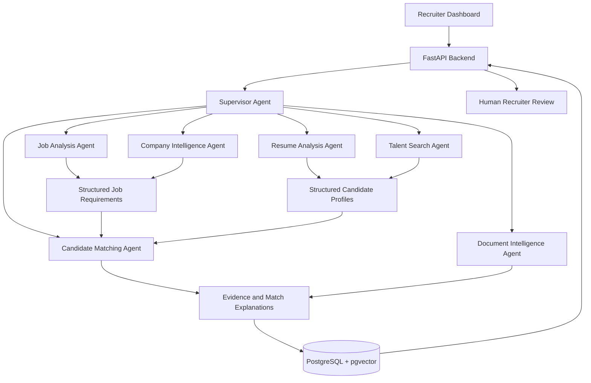
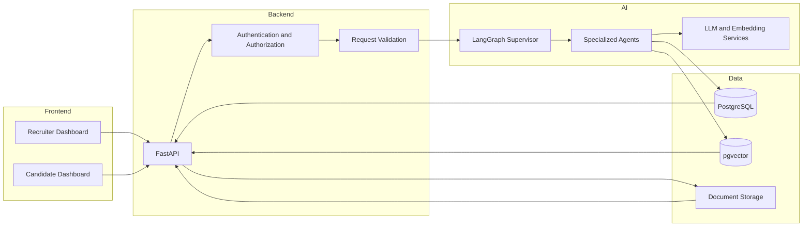

# 🚀 AI JOB POST — End-to-End AI Hiring Agent

### Find the Right Talent Faster with AI Agents

**One Job. Hundreds of Applications. One Intelligent Hiring Pipeline.**

AI JOB POST is an AI-powered recruitment platform designed to help recruiters analyze job descriptions, organize candidate profiles, discover relevant talent, compare qualifications, and build evidence-based candidate shortlists through a coordinated multi-agent workflow.

The platform brings together recruiter and candidate dashboards, resume intelligence, semantic talent search, company research, candidate matching, and document analysis in one connected hiring experience.

> **Project Vision:** Transform recruitment from a manual, resume-heavy process into an intelligent, structured, and human-centered talent discovery workflow.

---

## 🌟 Overview

Recruiters often receive hundreds of applications for a single vacancy. Reviewing resumes, identifying relevant skills, validating candidate information, and comparing qualifications can consume significant time and effort.

AI JOB POST aims to simplify this process through AI-assisted recruitment workflows.

The platform is designed to:

- Convert job descriptions into structured hiring requirements.
- Extract relevant information from candidate resumes.
- Organize candidate information into searchable profiles.
- Search for suitable candidates using keywords and semantic retrieval.
- Coordinate specialized AI agents through a supervisor workflow.
- Compare candidate qualifications against job requirements.
- Present supporting evidence and potential information gaps.
- Help recruiters create focused candidate shortlists.
- Keep final hiring decisions under human control.

**Important:** Features described as planned or architectural capabilities require implementation and testing before they can be considered production-ready.

---

## 🎯 The Problem

Traditional recruitment workflows frequently involve:

- Manually reviewing large volumes of resumes.
- Repeatedly searching for the same skills and qualifications.
- Inconsistent candidate information across documents.
- Difficulty identifying transferable or semantically similar skills.
- Time-consuming comparisons between applicants.
- Limited visibility into the evidence supporting a candidate match.
- Fragmented recruitment tools and disconnected information.

These challenges can make it harder for hiring teams to focus on meaningful candidate evaluation.

## 💡 Our Solution

AI JOB POST introduces a coordinated AI-assisted workflow that connects job analysis, candidate profiling, talent discovery, document intelligence, and recruiter review.

Instead of treating each resume as an isolated document, the platform is designed to organize recruitment information into structured, searchable records.

### Core Workflow

```text
Job Description
      |
      v
Job Analysis Agent
      |
      v
Structured Job Requirements
      |
      v
Candidate Discovery
      |
      v
Resume Analysis and Profile Extraction
      |
      v
Semantic Search and Candidate Matching
      |
      v
Evidence-Based Candidate Shortlist
      |
      v
Human Recruiter Review
      |
      v
Interview Selection
```

---

## ✨ Key Features

### 1. 👨‍💼 Recruiter Dashboard

A centralized workspace for recruiters to manage hiring activities.

**Planned capabilities:**

- Create and manage job openings.
- Review job requirements.
- View candidate applications.
- Search candidate profiles.
- Compare candidate qualifications.
- Review matching explanations.
- Track document-review status.
- Create and manage shortlists.
- Select candidates for interviews.

### 2. 👤 Candidate Dashboard

A candidate-facing interface for participating in the recruitment process.

**Planned capabilities:**

- Create and update candidate profiles.
- Upload resumes and supporting documents.
- Manage professional information.
- View relevant job opportunities.
- Track application status.
- Review available profile information.

Access to sensitive application information should be restricted according to the platform's authorization policies.

### 3. 🧠 AI-Powered Job Analysis

The Job Analysis Agent processes job descriptions and identifies structured requirements.

It can be designed to extract:

- Required technical skills.
- Preferred skills.
- Years or level of experience.
- Educational requirements.
- Relevant certifications.
- Project experience.
- Role responsibilities.
- Job-specific qualifications.

Example input:

```text
Job Title: Machine Learning Engineer

Required Skills:
- Python
- Machine Learning
- SQL
- Data Processing

Preferred Skills:
- PyTorch
- Computer Vision
- Model Deployment
```

Example structured output:

```json
{
  "job_title": "Machine Learning Engineer",
  "required_skills": [
    "Python",
    "Machine Learning",
    "SQL",
    "Data Processing"
  ],
  "preferred_skills": [
    "PyTorch",
    "Computer Vision",
    "Model Deployment"
  ],
  "requirements_version": "1.0"
}
```

The exact schema should be validated and adapted to the application's data model.

### 4. 📄 Intelligent Resume Analysis

The resume-processing workflow extracts relevant information from supported document formats.

Potential capabilities include:

- PDF and DOCX text extraction.
- OCR for supported scanned documents.
- Candidate profile normalization.
- Technical skill extraction.
- Education and experience extraction.
- Project and certification identification.
- Structured data validation.
- Human review of uncertain information.

The system should preserve links to source documents and relevant text evidence so recruiters can verify extracted claims.

### 5. 🔎 Semantic Talent Search

Traditional keyword searches can miss relevant candidates when resumes use different terminology to describe similar skills.

AI JOB POST is designed to support a combination of:

- Keyword search.
- Skill-based filtering.
- Metadata filtering.
- Vector embeddings.
- Semantic similarity search.
- Requirement-based candidate retrieval.

Example query:

```text
Find Python developers with machine learning experience.
```

The search workflow can identify profiles containing relevant terminology, related projects, and semantically similar descriptions.

Semantic similarity should be treated as a retrieval signal, not proof that a candidate meets a requirement.

### 6. 🎯 Candidate Matching and Ranking

The matching engine compares structured job requirements with candidate information.

Potential comparison dimensions include:

- Required skills.
- Relevant experience.
- Project evidence.
- Education, when relevant to the role.
- Certifications, when required.
- Preferred qualifications.
- Missing or unverified information.

Example comparison:

| Requirement | Candidate Evidence | Review Status |
|---|---|---|
| Python | Python listed in skills and projects | Evidence found |
| Machine Learning | ML project described in resume | Evidence found |
| SQL | SQL listed in skills | Evidence found |
| PyTorch | Not identified in the available profile | Not found; verify if necessary |

A match score, if implemented, should be explainable and configurable. It should not be presented as an objective measure of a person's ability or potential.

### 7. 🏢 Company Intelligence

The Company Intelligence Agent is designed to organize relevant company and job information from authorized sources.

Potential capabilities include:

- Company profile enrichment.
- Public company information retrieval.
- Job opportunity research.
- Source attribution.
- Research result summarization.
- Structured company records.

External data collection must respect source terms, privacy requirements, access restrictions, and applicable law.

### 8. 📑 Document Intelligence

Document Intelligence supports the review of recruitment documents and extracted candidate information.

Potential capabilities include:

- Document classification.
- Field extraction.
- Document completeness checks.
- Inconsistency detection.
- Missing-information identification.
- Evidence linking.
- Human review queues.

**Important:** An inconsistency or extraction mismatch is not proof of fraud. The system should flag uncertain findings for human verification rather than make unsupported accusations.

### 9. 🤖 Multi-Agent AI Workflow

AI JOB POST is designed around a supervisor-led architecture in which specialized agents handle different tasks.

Using LangGraph for workflow orchestration and LangChain for model and tool integration, the proposed system can coordinate analysis, retrieval, matching, and review tasks.

### 10. 📊 Evidence-Based Shortlisting

The final recruiter workspace is designed to present candidates with contextual information, including:

- Relevant skills.
- Experience summaries.
- Project evidence.
- Matching requirements.
- Missing information.
- Document-review indicators.
- Source references.

Recruiters remain responsible for evaluating candidates and deciding whom to interview.

---

## 🤖 AI Agent Architecture

The proposed architecture consists of a Supervisor Agent and specialized agents.



### Supervisor Agent

The Supervisor Agent coordinates the overall workflow.

Its responsibilities can include:

- Interpreting incoming requests.
- Selecting the appropriate workflow.
- Delegating tasks to specialized agents.
- Managing task dependencies.
- Validating structured agent outputs.
- Handling errors and retries.
- Aggregating results.
- Returning a consistent response to the application.

The supervisor should enforce authorization boundaries and must not grant agents unrestricted access to sensitive candidate information.

### Job Analysis Agent

Converts natural-language job descriptions into structured requirements.

### Company Intelligence Agent

Retrieves and organizes relevant company information from permitted sources.

### Resume Analysis Agent

Extracts and normalizes candidate information from supported documents.

### Talent Search Agent

Finds potentially relevant candidates using keyword search, metadata filters, and semantic retrieval.

### Candidate Matching Agent

Compares job requirements with available candidate evidence and produces explainable comparison results.

### Document Intelligence Agent

Checks document completeness, extracts relevant fields, and flags inconsistencies for review.

---

## 🔄 How It Works

### Step 1 — Create a Job

The recruiter enters a job title, description, required skills, and relevant qualifications.

### Step 2 — Analyze Requirements

The Job Analysis Agent converts the job description into a structured requirements record.

### Step 3 — Process Applications

Candidate resumes are uploaded, parsed, and normalized into structured profiles.

### Step 4 — Discover Candidates

The Talent Search Agent searches the authorized candidate pool and permitted external sources.

### Step 5 — Compare Candidates

The matching workflow compares candidate evidence with the job requirements.

### Step 6 — Review Documents

The Document Intelligence Agent identifies missing fields and potential inconsistencies for human verification.

### Step 7 — Generate a Shortlist

The system presents relevant candidate profiles, supporting evidence, and explanations.

### Step 8 — Make the Hiring Decision

The recruiter reviews the available evidence and independently decides which candidates should proceed.

---

## 🛠️ Technology Stack

The following technologies form the proposed platform stack. Actual dependencies should be confirmed against the implementation.

| Layer | Technology | Purpose |
|---|---|---|
| Frontend | React | User interface |
| Language | TypeScript | Frontend type safety |
| Styling | Tailwind CSS | Responsive interface styling |
| Backend | FastAPI | API and application services |
| AI Orchestration | LangGraph | Workflow and agent coordination |
| AI Integration | LangChain | Model and tool integration |
| Language Models | Configured LLM provider | Text analysis and reasoning |
| Data Validation | Pydantic | Request and structured-output validation |
| Document Processing | Python libraries and OCR | Text extraction and document processing |
| Database | PostgreSQL | Persistent application data |
| Vector Search | pgvector | Semantic retrieval |
| Database Platform | Supabase, if configured | Managed database and supporting services |
| Cloud | Google Cloud, if configured | Potential hosting and infrastructure |
| Data Format | JSON | Structured application data |
| Source Control | Git and GitHub | Version control and collaboration |

### Technology Notes

- **Supabase** is a platform that can provide managed PostgreSQL and related services. Use only the services actually configured in the project.
- **pgvector** supports vector storage and similarity search in PostgreSQL.
- **Google Cloud** is an optional deployment environment, not an automatic dependency.
- **Google OKF** and **Jev AI** require clear definitions and verified implementation details before being described as integrated components.
- Model providers, embedding models, OCR engines, and search connectors should be documented according to the actual project configuration.

---

## 🏗️ System Architecture

The platform separates the user interface, backend APIs, AI workflows, and persistent data storage.



### Architectural Principles

- Keep frontend and backend responsibilities separate.
- Validate inputs and model outputs.
- Apply authentication and role-based authorization.
- Store structured data in a consistent schema.
- Use semantic retrieval alongside conventional filtering.
- Keep sensitive documents in access-controlled storage.
- Log operational events without unnecessarily recording personal data.
- Make agent workflows observable and testable.
- Require human review for consequential hiring decisions.

---

## 🎯 Candidate Matching

A reliable matching system should use explicit, job-related criteria rather than an unexplained model-generated score.

### Example Matching Pipeline

```text
Structured Job Requirements
           |
           v
Candidate Retrieval
           |
           v
Required-Skill Comparison
           |
           v
Experience and Project Evidence
           |
           v
Missing Information Detection
           |
           v
Explainable Candidate Comparison
           |
           v
Human Review
```

### Example Response Format

```json
{
  "candidate_id": "candidate_demo_001",
  "job_id": "job_demo_001",
  "matched_requirements": [
    {
      "requirement": "Python",
      "evidence": "Python is listed in the skills section",
      "source": "resume"
    },
    {
      "requirement": "Machine Learning",
      "evidence": "A machine learning project is described",
      "source": "project_section"
    }
  ],
  "unverified_requirements": [
    "Professional machine learning experience"
  ],
  "review_required": true
}
```

This is an illustrative schema, not a claim that the application currently returns this exact response.

### Matching Best Practices

- Separate required and preferred qualifications.
- Show evidence for extracted claims.
- Distinguish missing information from confirmed lack of a skill.
- Avoid inferring protected characteristics.
- Do not rank candidates based on irrelevant personal information.
- Test retrieval and ranking against representative datasets.
- Audit outcomes for systematic errors and disparate impact.
- Keep the recruiter in control of the final decision.

---

## 📑 Document Intelligence

The document workflow can process resumes and supporting documents to extract information for review.

### Suggested Processing Stages

1. Validate the uploaded file type and size.
2. Store the document securely.
3. Extract text from supported file formats.
4. Apply OCR when necessary and supported.
5. Extract structured fields.
6. Validate extracted fields against a defined schema.
7. Link extracted information to source evidence.
8. Flag uncertain values and discrepancies.
9. Present results for human verification.

### Supported Formats

The application should explicitly document the formats implemented and tested. Common targets include:

- PDF
- DOCX
- TXT
- Scanned documents, when supported by the configured OCR pipeline

Do not assume every format is supported merely because a relevant library is listed as a dependency.

---

## 🔐 Responsible AI and Security

AI JOB POST is intended to assist recruitment teams, not autonomously determine a person's employment prospects.

### Human-in-the-Loop Hiring

- Recruiters make final interview and hiring decisions.
- AI-generated matches are advisory.
- Candidates should not be rejected solely because of an AI-generated score.
- Missing information should not automatically be interpreted as a negative qualification.
- Recruiters should be able to inspect evidence and challenge incorrect outputs.

### Data Protection

- Enforce authentication and role-based access control.
- Protect candidate records and uploaded documents.
- Use encrypted connections.
- Keep secrets out of source control.
- Apply least-privilege access to databases and storage.
- Define retention and deletion policies.
- Avoid sending unnecessary personal information to external model providers.
- Record relevant data-processing and access events.
- Follow applicable privacy and employment laws.

### AI Reliability

- Validate structured model responses.
- Handle hallucinations and extraction errors.
- Use source evidence wherever possible.
- Apply rate limits and timeouts.
- Implement controlled retries.
- Monitor model failures and workflow errors.
- Evaluate candidate-matching quality before production use.

### Security Checklist

- [ ] Authentication and authorization are implemented.
- [ ] Candidate data is isolated by access permissions.
- [ ] Uploaded documents are validated.
- [ ] File size and upload limits are enforced.
- [ ] API inputs are validated.
- [ ] Secrets are stored in environment variables or a secret manager.
- [ ] Database access follows least privilege.
- [ ] External integrations are authorized.
- [ ] Logs avoid unnecessary sensitive information.
- [ ] AI outputs are validated and reviewed.
- [ ] Dependency and security checks are part of CI.

---

## 📁 Project Structure

The following is a suggested monorepo layout. Adapt it to match the actual repository.

```text
ai-job-post/
├── frontend/
│   ├── src/
│   │   ├── components/
│   │   ├── pages/
│   │   ├── features/
│   │   ├── services/
│   │   ├── hooks/
│   │   └── types/
│   ├── public/
│   ├── package.json
│   └── README.md
│
├── backend/
│   ├── app/
│   │   ├── api/
│   │   ├── core/
│   │   ├── models/
│   │   ├── schemas/
│   │   ├── services/
│   │   ├── agents/
│   │   ├── workflows/
│   │   ├── document_processing/
│   │   └── main.py
│   ├── tests/
│   └── requirements.txt
│
├── database/
│   ├── migrations/
│   └── schemas/
│
├── docs/
│   ├── architecture.md
│   ├── api.md
│   └── security.md
│
├── .env.example
├── .gitignore
└── README.md
```

---

## 🚀 Getting Started

The following instructions describe a typical development setup. Commands and dependencies may need adjustment to match the actual repository.

### Prerequisites

Install the tools required by your chosen stack:

- Git
- Node.js and npm
- Python
- PostgreSQL, or a configured Supabase project
- An API key for your selected LLM provider, if required
- pgvector, if semantic vector search is enabled

### 1. Clone the Repository

Replace the placeholder with your actual repository URL.

```bash
git clone <YOUR_REPOSITORY_URL>
cd ai-job-post
```

### 2. Configure Environment Variables

Create a local environment file based on the example:

```bash
cp .env.example .env
```

On Windows PowerShell:

```powershell
Copy-Item .env.example .env
```

Add the required database settings, model provider credentials, and application configuration. Never commit your real `.env` file.

### 3. Set Up the Backend

Move into the backend directory:

```bash
cd backend
```

Create a virtual environment:

```bash
python -m venv .venv
```

Activate it on Windows:

```powershell
.venv\Scripts\Activate.ps1
```

Activate it on macOS or Linux:

```bash
source .venv/bin/activate
```

Install dependencies:

```bash
pip install -r requirements.txt
```

Start the API if the project exposes `app.main:app`:

```bash
uvicorn app.main:app --reload
```

If configured with the default FastAPI development setup, the API is available at:

```text
http://localhost:8000
```

Interactive API documentation is typically available at:

```text
http://localhost:8000/docs
```

These endpoints depend on the actual application configuration.

### 4. Set Up the Frontend

Open a second terminal and enter the frontend directory:

```bash
cd frontend
```

Install dependencies:

```bash
npm install
```

Start the development server:

```bash
npm run dev
```

The frontend URL depends on the development server configuration.

### 5. Configure the Database

Configure your PostgreSQL connection and apply the migrations provided by the project.

If using pgvector, ensure the extension is enabled in the target database and that the vector dimensions match the configured embedding model.

Do not assume the database schema exists until migrations have been applied and verified.

### 6. Verify the Installation

- Confirm the frontend loads.
- Confirm the backend health endpoint, if implemented.
- Confirm the database connection.
- Test authentication and role permissions.
- Test resume upload and extraction.
- Test job-description analysis.
- Test candidate search.
- Test error handling when the LLM provider is unavailable.

---

## 🔑 Environment Variables

Create a `.env.example` file containing placeholder values appropriate to your implementation.

Example:

```dotenv
APP_ENV=development
API_HOST=127.0.0.1
API_PORT=8000

DATABASE_URL=

SUPABASE_URL=
SUPABASE_PUBLISHABLE_KEY=
SUPABASE_SECRET_KEY=

LLM_PROVIDER=
LLM_API_KEY=
LLM_MODEL=

EMBEDDING_MODEL=
VECTOR_DIMENSIONS=

DOCUMENT_STORAGE_BUCKET=
LOG_LEVEL=INFO
```

### Environment Variable Guidance

- `APP_ENV`: Application environment.
- `DATABASE_URL`: PostgreSQL connection string, if used.
- `SUPABASE_URL`: Supabase project URL, if Supabase is configured.
- `SUPABASE_PUBLISHABLE_KEY`: Public client key where appropriate.
- `SUPABASE_SECRET_KEY`: Server-side secret key, if applicable to the project's Supabase key configuration.
- `LLM_PROVIDER`: Configured model provider.
- `LLM_API_KEY`: Server-side credential for the model provider.
- `LLM_MODEL`: Model identifier supported by the configured provider.
- `EMBEDDING_MODEL`: Model used to generate search embeddings.
- `VECTOR_DIMENSIONS`: Vector size matching the selected embedding model.
- `DOCUMENT_STORAGE_BUCKET`: Configured document-storage bucket.
- `LOG_LEVEL`: Application logging verbosity.

Use only the variables your implementation requires. Names differ between services and versions, so confirm them against the actual SDK and project configuration.

**Security:** Never expose database passwords, server-side secret keys, service-role credentials, or LLM API keys in frontend code or public repositories.

---

## 🔌 API Design

The following endpoints are examples for planning an API. They are not claims that these routes are already implemented.

| Method | Example Endpoint | Purpose |
|---|---|---|
| GET | `/health` | Health check |
| POST | `/api/jobs` | Create a job |
| POST | `/api/jobs/analyze` | Analyze job requirements |
| GET | `/api/jobs` | List authorized jobs |
| POST | `/api/resumes/upload` | Upload a resume |
| POST | `/api/resumes/analyze` | Extract candidate information |
| POST | `/api/candidates/search` | Search candidate profiles |
| POST | `/api/candidates/match` | Compare candidates with a job |
| GET | `/api/candidates/{candidate_id}` | Retrieve an authorized candidate profile |
| GET | `/api/applications` | List authorized applications |
| POST | `/api/documents/review` | Request document analysis |

### API Design Principles

- Use Pydantic schemas for request and response validation.
- Enforce authentication and authorization on every protected route.
- Apply pagination to large result sets.
- Add upload size and file-type limits.
- Use consistent error responses.
- Avoid exposing sensitive candidate data unnecessarily.
- Add rate limits and request timeouts where appropriate.
- Document implemented endpoints using OpenAPI.

---

## 🗺️ Development Roadmap

The following roadmap is a suggested development plan, not a statement of current completion status.

### Phase 1 — Core Platform

- [ ] Recruiter dashboard.
- [ ] Candidate dashboard.
- [ ] Authentication and authorization.
- [ ] Job creation and management.
- [ ] Candidate profile management.
- [ ] Database schema and migrations.

### Phase 2 — Resume Intelligence

- [ ] Resume upload.
- [ ] PDF and DOCX extraction.
- [ ] OCR integration where required.
- [ ] Structured candidate profiles.
- [ ] Schema validation.
- [ ] Source evidence tracking.

### Phase 3 — AI Agent Workflows

- [ ] Job Analysis Agent.
- [ ] Resume Analysis Agent.
- [ ] Supervisor Agent.
- [ ] LangGraph workflow orchestration.
- [ ] LangChain model and tool integration.
- [ ] Structured output validation.
- [ ] Error handling and observability.

### Phase 4 — Search and Matching

- [ ] Candidate keyword search.
- [ ] PostgreSQL filtering.
- [ ] Embedding generation.
- [ ] pgvector integration.
- [ ] Candidate comparison.
- [ ] Explainable match results.
- [ ] Recruiter shortlist workflow.

### Phase 5 — Document and Company Intelligence

- [ ] Document Intelligence Agent.
- [ ] Company Intelligence Agent.
- [ ] Authorized external search integrations.
- [ ] Document discrepancy review.
- [ ] Source attribution.
- [ ] Human verification workflow.

### Phase 6 — Production Readiness

- [ ] Automated tests.
- [ ] Security review.
- [ ] Privacy and retention policies.
- [ ] AI quality evaluation.
- [ ] Accessibility testing.
- [ ] Performance testing.
- [ ] Deployment configuration.
- [ ] Monitoring and incident response.

---

## 🔮 Future Enhancements

Potential future improvements include:

- Multilingual resume processing.
- Multilingual job-description analysis.
- Advanced talent search.
- Recruiter-configurable matching criteria.
- Candidate skill-gap summaries.
- Recruitment analytics dashboards.
- Interview scheduling integrations.
- Candidate communication workflows.
- Additional document formats.
- Human-reviewed extraction corrections.
- Workflow monitoring and evaluation dashboards.
- Fairness and matching-quality audits.
- Configurable model providers.
- Improved accessibility and mobile responsiveness.

These enhancements should be prioritized according to user needs, technical feasibility, privacy requirements, and evaluation results.

---

## 🧪 Testing

A production-oriented implementation should include automated and manual testing.

### Backend Tests

- API input validation.
- Authentication and authorization.
- Database operations.
- Resume parsing.
- Structured model output validation.
- Search and matching behavior.
- Agent workflow failure handling.
- File upload restrictions.

### Frontend Tests

- Dashboard rendering.
- Form validation.
- Loading and error states.
- Search filters.
- Candidate profile display.
- Responsive layouts.
- Role-based interface behavior.

### AI Evaluation

- Extraction accuracy.
- Search relevance.
- Matching consistency.
- Evidence correctness.
- Hallucination rates.
- Performance across different resume formats.
- Fairness and potential disparate impact.
- Robustness to malformed documents and adversarial inputs.

Use synthetic or appropriately authorized test data. Do not use real candidate information in public demonstrations without a valid basis and suitable safeguards.

---

## 🤝 Contributing

Contributions, bug reports, and suggestions are welcome.

Suggested contribution process:

1. Fork the repository.
2. Create a feature branch.
3. Make a focused change.
4. Add or update relevant tests.
5. Run the available checks.
6. Submit a pull request describing the change.

Please avoid including API keys, personal candidate data, confidential documents, or production credentials in issues and pull requests.

---

## 👨‍💻 Author

**Prince Kumar Kapri**

AI and software development enthusiast focused on AI-powered applications, intelligent workflows, and full-stack development.

---

## 📄 License

Choose and add an appropriate open-source license before distributing this project.

If no license has been added, all rights remain reserved by the copyright holder by default. Do not describe the project as open source until a suitable license is included.

---

## ⭐ Support the Project

If you find AI JOB POST interesting, consider starring the repository and sharing feedback.

Contributions and suggestions can help improve the platform's usability, reliability, and responsible application of AI in recruitment.

**AI JOB POST — Find the Right Talent Faster with AI Agents.**

*One Job. Smarter Search. Better-Informed Hiring.*
