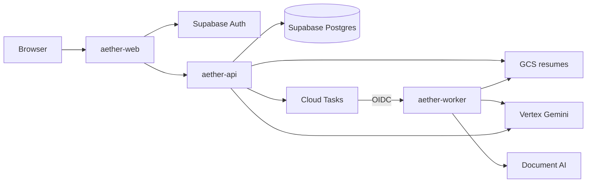

# AI Job Post architecture

AI recruitment platform monorepo (**ai-job-post**). Production Cloud Run services (GCP): **aether-web**, **aether-api**, **aether-worker**.

## Services

| Service | Folder | Role |
| --- | --- | --- |
| **aether-web** | `frontend/` | Next.js App Router UI. Supabase Auth in browser/server; calls FastAPI backend. |
| **aether-api** | `backend/` | FastAPI API. Verifies Supabase JWTs, reads/writes PostgreSQL (JSONB + pgvector), stores resumes in GCS, enqueues Cloud Tasks, calls Vertex Gemini. |
| **aether-worker** | `worker/` | HTTP worker (internal ingress). Parses resumes (Document AI / pypdf / Gemini OCR), calls Vertex for profile extraction, callbacks to API with `WORKER_SHARED_SECRET`. |

## Data and auth

- **Supabase PostgreSQL** is the system of record (candidates, companies, jobs, embeddings, matching runs).
- **Row Level Security** is enabled on every `public` table. Policies use `auth.uid()` and `app_metadata` — never `user_metadata`.
- **Resume files** — GCS in staging/production (`GCS_BUCKET`); local disk or temp dir when `ENVIRONMENT=local`.
- **Frontend** uses the Supabase publishable key only. The service role key never ships to the browser.
- **Backend** authorizes from verified JWT claims (`sub`, `role`, `app_metadata`).

## Production hosting

Deploy pipeline: GitHub → Cloud Build → Artifact Registry → Cloud Run.

See [DEPLOYMENT.md](DEPLOYMENT.md) for setup and [env-where.md](env-where.md) for configuration.

## Key flows

### Resume upload

1. Candidate uploads file via `aether-web` → `aether-api`
2. API stores bytes in GCS, enqueues Cloud Tasks job
3. Cloud Tasks POSTs to `aether-worker/tasks` with OIDC
4. Worker reads from GCS, runs OCR (Document AI or Gemini), extracts profile JSON via Vertex
5. Worker callbacks `aether-api/v1/internal/worker/resume-complete`
6. Candidate reviews and applies parsed profile

### Job ranking

- **Portal** — ranks registered candidates in the database against a published job (`POST /v1/jobs/{id}/rank/portal`)
- **Internet** — searches GitHub, portfolio sites, Reddit; LinkedIn is skipped (authorized API required); ranks external candidates (`POST /v1/jobs/{id}/rank/internet`)

Both use Python scoring engines with optional Vertex Gemini match narratives.
